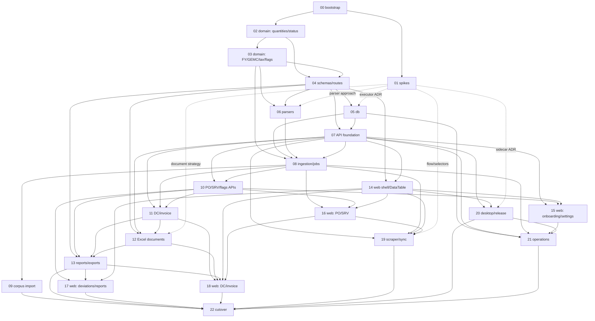

# SenstoSales — Implementation specs

Written from `docs/ARCHITECTURE.md` rev 1 (the single source of truth, with the owner's 2026-10-14 amendments to
C15, C16 and the Vite+ toolchain), `docs/INVARIANTS.md` and `docs/EDGE_CASES.md`. Each spec follows the same
template: summary, scope / out of scope, dependencies, design, invariants, testing strategy, acceptance criteria,
PR plan, open issues. Specs are numbered in implementation order. If a spec would change an architectural decision,
it does not: the point is listed in its Open issues and escalated, and only an owner-approved ARCHITECTURE revision
changes it.

Rules every spec follows:
- **No invented business rules.** Every rule cites the legacy business spec (`spec §n`), an owner decision (`A-n`,
  `A2-n`) or an invariant (`INV-NN`). Under-specified mechanics take the most conservative reading, are marked
  "implementation detail" and are listed in Open issues (and DECISIONS.md when implemented). Uncovered business
  edge cases go to `EDGE_CASES.md` with the spec's behaviour (C18).
- **Frozen output, free mechanism.** The UI/UX and the CSV/Excel formats must match legacy visible output (golden
  tests, screenshots); how they are built is new and the simplest efficient way (A-2, A-26, C16).
- **No layout shift** (A-23, C8) is an acceptance criterion of every frontend spec.
- **No candidates.** MCP, Telegram, finance, the supplier switcher, Cloudflare hosting, hosted auth, code signing,
  scraping fallbacks and encrypted secrets (ARCHITECTURE §17, K1–K9) have no spec.
- **Public repo.** No real data anywhere (C1); fixtures are anonymised or synthetic; corpus tests read
  `SENSTO_CORPUS_DIR` and run locally only.

## Index

| # | Spec | Architecture sections | Depends on | Layer | PRs |
|---|---|---|---|---|---|
| 00 | [Repo bootstrap and engineering foundations](SPEC-00-repo-bootstrap.md) | §2, §4, §14.2, §14.3, §16 | — | L0 | 4 |
| 01 | [Spikes](SPEC-01-spikes.md) | §15 L0.5, §4.1, §7, §11.1, §13.1 | 00 | L0.5 | 5 |
| 02 | [Domain: units, quantities, received/rejected, status](SPEC-02-domain-quantities-receipt-status.md) | §5, §6.1–§6.3, §6.8, §6.11 | 00 | L1 | 4 |
| 03 | [Domain: FY, GEMC, tax, links, guards, flags](SPEC-03-domain-fy-gemc-tax-links-flags.md) | §6.4–§6.7, §6.9, §6.10, §7.2 | 02 | L1 | 6 |
| 04 | [Schemas, route table and formatters](SPEC-04-schemas-routes-formatters.md) | §4, §9, §11.2, §12.1 | 02, 03 | L1–L2 | 5 |
| 05 | [Database: schema, migrations, Db port, seed](SPEC-05-db-schema-migrations.md) | §4.1, §8 | 04, (01) | L2 | 5 |
| 06 | [BHEL parsers, fixtures, corpus test](SPEC-06-bhel-parsers-fixtures.md) | §7.1, §14.3 | 03, 04, (01) | L3 | 6 |
| 07 | [API foundation, startup, auth, onboarding, settings](SPEC-07-api-foundation-auth-settings.md) | §3, §4, §9, §10, §13.2, §13.3 | 04, 05 | L4 | 6 |
| 08 | [Ingestion services and jobs](SPEC-08-ingestion-jobs.md) | §4.1, §6.9, §6.10, §7.2–§7.4 | 03, 05, 06, 07 | L4 | 6 |
| 09 | [Corpus import and report (local)](SPEC-09-corpus-import-report.md) | §7.4, §14.1 | 08 | L4 | 3 |
| 10 | [PO, SRV, flags, audit, dashboard, search APIs](SPEC-10-po-srv-flags-read-api.md) | §6.8, §6.9, §6.11, §9, §12.2 | 07, 08 | L4 | 6 |
| 11 | [DC and invoice services and APIs](SPEC-11-dc-invoice-services.md) | §6.5–§6.7, §6.9, §6.10, §9 | 07, 08, 10 | L6 | 6 |
| 12 | [DC, invoice and GC Excel documents](SPEC-12-excel-documents.md) | §6.7, §11.1 | 04, 07, 11, (01) | L6 | 6 |
| 13 | [Reports and exports](SPEC-13-reports-exports.md) | §10.4, §11.2 | 04, 10, 11, 12 | L6 | 5 |
| 14 | [Web shell, design system, DataTable, platform](SPEC-14-web-shell-design-datatable.md) | §12.1–§12.4, §14.2 | 04, 07 | L5 | 8 |
| 15 | [Web: onboarding, login, settings, dashboard, search](SPEC-15-web-onboarding-login-settings-dashboard.md) | §10.1–§10.3, §12.2, §12.3 | 07, 10, 14 | L5 | 5 |
| 16 | [Web: PO and SRV screens, uploads, folder import](SPEC-16-web-po-srv-import.md) | §6.8, §7.4, §12.2, §12.3 | 08, 10, 14 | L5 | 5 |
| 17 | [Web: deviations, ledger, delivery tracker, reports](SPEC-17-web-deviations-ledger-tracker-reports.md) | §6.9, §11.2, §12.2 | 10, 13, 14 | L5–L6 | 4 |
| 18 | [Web: DC and invoice screens](SPEC-18-web-dc-invoice.md) | §6.5–§6.7, §11.1, §12 | 11, 12, 13, 14, 16 | L6 | 5 |
| 19 | [BHEL scraper and sync](SPEC-19-bhel-scraper-sync.md) | §4.1, §7.5, §10.2, §12.4 | 07, 08, 14, 16, (01) | L7 | 6 |
| 20 | [Desktop packaging and release](SPEC-20-desktop-packaging-release.md) | §3, §13.1–§13.3 | 07, 14, (01) | L8 | 5 |
| 21 | [Operations: backups, restore, logs, guide](SPEC-21-operations-backup-logs.md) | §8.3, §10.4, §13.2, §13.3 | 05, 07, 08, 15, 20 | L8 | 5 |
| 22 | [Cutover](SPEC-22-cutover.md) | §15 L9, §7.4 | 09, 13, 17, 18, 19, 20, 21 | L9 | 3 |

Total: 119 PR-plan rows. `(01)` means the spike's recorded decision is read first; it does not block rows whose
mechanism the spike does not touch.

## Dependency graph

The graph is acyclic (every edge goes from a lower to a higher spec number).

Layer mapping (ARCHITECTURE §15): L0 = 00. L0.5 = 01. L1 = 02, 03, 04. L2 = 05 (04 finishes here). L3 = 06.
L4 = 07, 08, 09, 10. L5 = 14, 15, 16, 17 (PRs 1–3). L6 = 11, 12, 13, 17 (PR 4), 18. L7 = 19. L8 = 20, 21. L9 = 22.
SPEC-11 (an L6 API) may start as soon as SPEC-10 is in; layers describe exit milestones, readiness is per row.

## Reading order

1. `docs/ARCHITECTURE.md` in full, then `INVARIANTS.md`, `EDGE_CASES.md`, `CLAUDE.md`.
2. SPEC-00 (toolchain, CI, contract enforcement, agent process) — everyone.
3. SPEC-01 records as they land (DECISIONS.md, `docs/adr/`).
4. Domain: SPEC-02 → SPEC-03. Shared types: SPEC-04. Storage: SPEC-05.
5. Ingestion: SPEC-06 → SPEC-07 → SPEC-08 → SPEC-09 (L4 exit: the full corpus imports through jobs).
6. APIs: SPEC-10 → SPEC-11; documents and exports: SPEC-12 → SPEC-13.
7. Web: SPEC-14 first, then SPEC-15, -16, -17, -18 alongside the APIs they use.
8. SPEC-19 (sync), SPEC-20 and SPEC-21 (packaging and operations), SPEC-22 (cutover).

## Cross-cutting facts

Fixed by one spec, relied on by others; later readers do not re-decide them.

- Toolchain: Vite+ (`vp lint` Oxlint, `vp fmt` Oxfmt, `vp test` Vitest with imports from `vite-plus/test`,
  `vp staged` hook, `vp dev/build` for the web app), TypeScript 7, pnpm, Node 24; local gate `pnpm verify`; CI job
  names `check`, `licenses`, `tools`, `real-data-scan`, `build`, `audit`, `e2e`, `desktop`: SPEC-00 §4.2, §4.5.
- C15 guardrails (800 lines, complexity 15, split never suppress; recurring findings become checks or regression
  tests): SPEC-00 §2, INV-109.
- Real-data scan rules, allowlist, the local company-details file (xlsx contents not scanned): SPEC-00 §4.6.
- Branded units and the decimal-string wire format: SPEC-02 §4.1, SPEC-04 §4.2.
- Flag types, fingerprints and the never-auto-close diff: SPEC-03 §4.2.
- Route table, list convention (`page`, `pageSize`, `sort`, `dir`, filters → `{ items, total }`), error body:
  SPEC-04 §4.3, SPEC-10 §4.2.
- Embedded migrations and the startup upgrade gate: SPEC-05 §4.1, SPEC-07 §4.2.
- `recompute(poId)` is the only writer of derived columns and flags; `reresolveLinks` the only link writer:
  SPEC-08 §4.1, SPEC-11 §4.1.
- Folder import uploads file contents to staging (no server-side paths, C17): SPEC-08 Open issues.
- Golden procedure for documents and exports (synthetic input, legacy output generated outside the repo, JSON
  snapshots): SPEC-12 §4.2, SPEC-13 PR 1.
- DataTable contract and the `expectNoLayoutShift` e2e helper: SPEC-14 §4.2, PR 8. Shared `JobProgress`: SPEC-16.
- ADR numbers: 0001 sidecar, 0002 DB executors, 0003 document generation (SPEC-01); 0004 `globals.css` token fixes
  (SPEC-14).
- Human-only tasks for `docs/plans/ACTIVE.md`: H1 rulesets and secret scanning (SPEC-00 PR 4); H2 dropped (D-0010); H3
  BHEL portal credentials and OTP mailbox on the owner's machine (SPEC-01 PR 2, SPEC-19 PR 6); H4 `SENSTO_CORPUS_DIR` on the build machine (SPEC-01 PR 5, SPEC-06 PR 6, SPEC-09 PR 3); H5 legacy
  app run on synthetic input for golden output (SPEC-01 PR 4, SPEC-12 PR 2, SPEC-13 PR 1); H6 Tauri updater key
  secret (SPEC-20 PR 5); H7 fresh Windows VM test (SPEC-20, SPEC-21 PR 5); H8 owner cutover and sign-off (SPEC-22).
- SPEC-00 PR 1 is the setup session's bootstrap and is marked `done` in ACTIVE.md when it merges.
- New invariants added by the specs: INV-94..INV-110. New edge cases: EC-16, EC-17.
